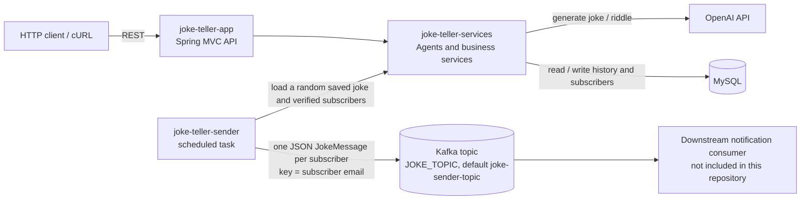

# Joke Teller

A Java 25 / Spring Boot multi-module application for generating jokes and riddles, managing email subscribers, and publishing scheduled joke notifications to Kafka.

## Architecture



The HTTP application handles interactive requests. The separate sender process runs on a schedule (every minute by default; configure `SENDER_SCHEDULE_CRON`) and selects one random joke from history, pages through subscribers, then publishes `{ "emailAddress": "...", "text": "..." }` messages to Kafka. The current sender iterates all subscriber records regardless of verification status. This repository publishes messages but does not include a Kafka consumer or email delivery service. Subscriber verification codes are logged by the mock email sender.

## Run locally

Set `OPENAI_API_KEY`, configure MySQL and `ADMIN_JWT_SECRET` (at least 32 characters), then run:

```bash
mvn clean install
java -jar ./joke-teller-app/target/joke-teller-0.0.1-SNAPSHOT.jar
```

Run MySQL and the HTTP application with Docker Compose:

```bash
docker compose up --build
```

The API listens on `http://localhost:8080`. The sender is a separate executable module and requires a reachable Kafka broker and database; see [joke-teller-sender/README.md](joke-teller-sender/README.md).

## API examples

All examples target `http://localhost:8080`. Public routes need no authentication. Admin routes, except login, need the bearer token obtained from login. The examples use shell variables so they can be pasted into Bash or Zsh.

### Health and joke/riddle routes

```bash
# Health checks
curl -i http://localhost:8080/api/hello
curl -i http://localhost:8080/api/health

# Generate a joke; prompt is optional
curl -G --data-urlencode 'prompt=Tell me a kid friendly joke about space' \
  http://localhost:8080/api/jokes
curl http://localhost:8080/api/jokes

# Get a previously saved random joke (404 when history is empty)
curl -i http://localhost:8080/api/jokes/random

# Generate a riddle; prompt is optional
curl -G --data-urlencode 'prompt=Give me a riddle about the ocean' \
  http://localhost:8080/api/riddles
curl http://localhost:8080/api/riddles
```

### Subscriber routes

```bash
# Request a subscription (also available at POST /api/subscriptions)
curl -i -X POST http://localhost:8080/api/subscribers \
  -H 'Content-Type: application/json' \
  -d '{"email":"jane@example.com"}'

# The mock email sender prints the six-digit code in the application log.
curl -i -X POST http://localhost:8080/api/subscribers/verify \
  -H 'Content-Type: application/json' \
  -d '{"email":"jane@example.com","code":"123456"}'
```

### Admin routes

Set a local variable for subsequent authenticated requests. The bootstrap admin account is configured with `ADMIN_BOOTSTRAP_USERNAME` and `ADMIN_BOOTSTRAP_PASSWORD` when the application starts.

```bash
TOKEN=$(curl -sS -X POST http://localhost:8080/api/admin/auth/login \
  -H 'Content-Type: application/json' \
  -d '{"username":"admin","password":"replace-with-your-password"}' \
  | python3 -c 'import json,sys; print(json.load(sys.stdin)["token"])')

# Check the logged-in account
curl -i http://localhost:8080/api/admin/me \
  -H "Authorization: Bearer $TOKEN"

# List admin users
curl -i http://localhost:8080/api/admin/users \
  -H "Authorization: Bearer $TOKEN"

# Create an admin (password must be 12-200 characters)
curl -i -X POST http://localhost:8080/api/admin/users \
  -H "Authorization: Bearer $TOKEN" -H 'Content-Type: application/json' \
  -d '{"username":"operator","password":"a-long-password-123"}'

# Update an admin; username and password are optional fields
curl -i -X PUT http://localhost:8080/api/admin/users/1 \
  -H "Authorization: Bearer $TOKEN" -H 'Content-Type: application/json' \
  -d '{"username":"operator-updated","password":"another-long-password-123"}'

# Delete an admin (the final admin cannot be deleted)
curl -i -X DELETE http://localhost:8080/api/admin/users/2 \
  -H "Authorization: Bearer $TOKEN"

# List subscriptions (optional Spring pageable parameters: page, size, sort)
curl -i 'http://localhost:8080/api/admin/subscriptions?page=0&size=20' \
  -H "Authorization: Bearer $TOKEN"

# Create a subscription directly as an admin
curl -i -X POST http://localhost:8080/api/admin/subscriptions \
  -H "Authorization: Bearer $TOKEN" -H 'Content-Type: application/json' \
  -d '{"email":"alex@example.com"}'

# Update a subscription by its numeric ID
curl -i -X PUT http://localhost:8080/api/admin/subscriptions/1 \
  -H "Authorization: Bearer $TOKEN" -H 'Content-Type: application/json' \
  -d '{"email":"alex@example.com","verified":true}'

# Delete a subscription by its numeric ID
curl -i -X DELETE http://localhost:8080/api/admin/subscriptions/1 \
  -H "Authorization: Bearer $TOKEN"

# Invalidate active tokens for this admin account
curl -i -X POST http://localhost:8080/api/admin/auth/logout \
  -H "Authorization: Bearer $TOKEN"
```

## Modules

- [joke-teller-app](joke-teller-app/README.md): HTTP API and admin authentication.
- [joke-teller-services](joke-teller-services/README.md): agents, persistence entities, repositories, and business services.
- [joke-teller-sender](joke-teller-sender/README.md): scheduled Kafka publisher.

## Configuration

The app and sender use MySQL settings under `spring.datasource.*` and an OpenAI API key supplied as `OPENAI_API_KEY` (`openai.api-key`). Admin token settings are `ADMIN_JWT_SECRET` and `ADMIN_JWT_LIFETIME_SECONDS`; initial account settings are `ADMIN_BOOTSTRAP_USERNAME` and `ADMIN_BOOTSTRAP_PASSWORD`. Sender settings include `KAFKA_BOOTSTRAP_SERVERS` (default `localhost:9092`), `JOKE_TOPIC` (default `joke-sender-topic`), and `SENDER_SCHEDULE_CRON` (Spring cron expression, default `0 * * * * *`).
